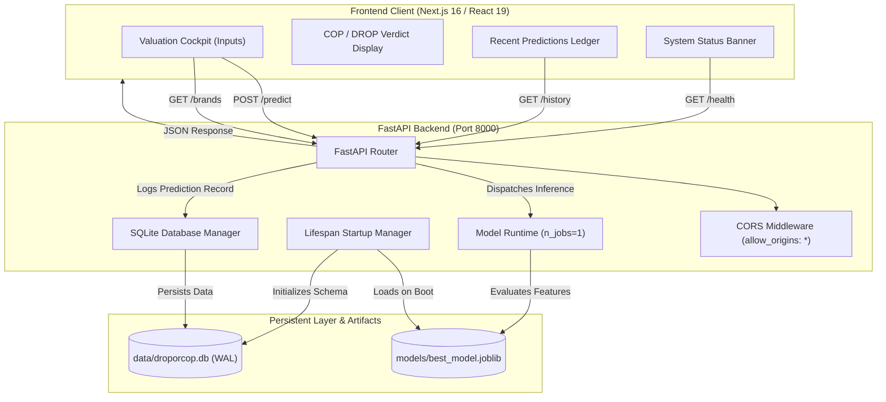
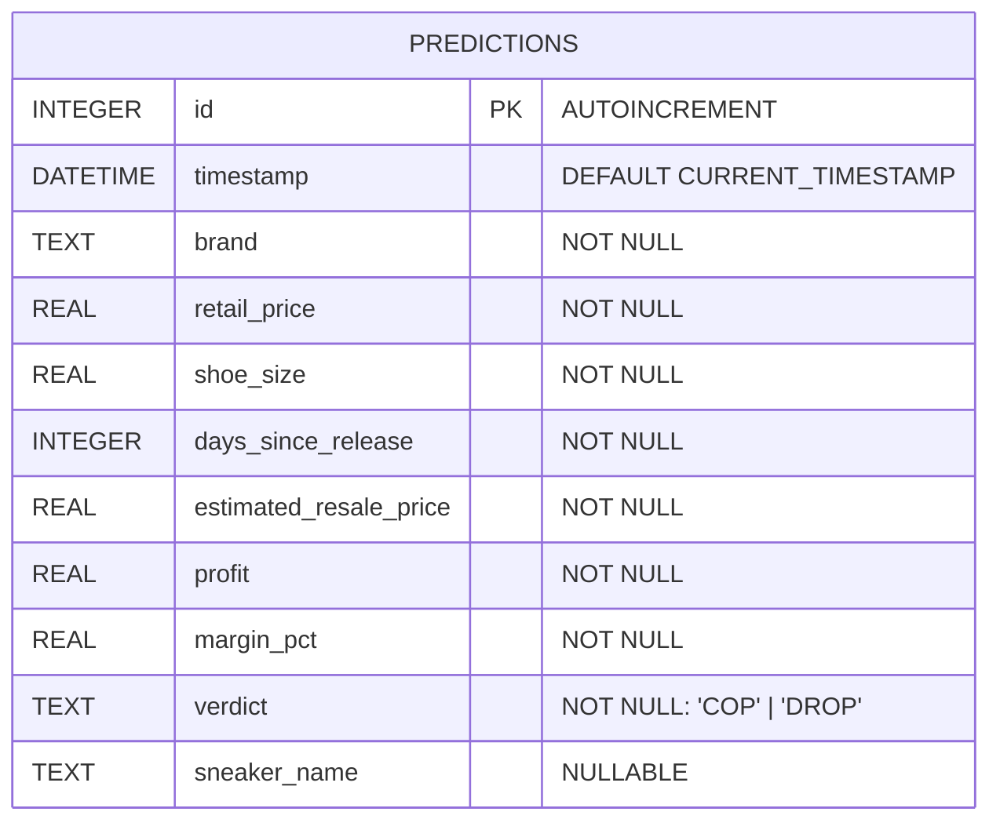
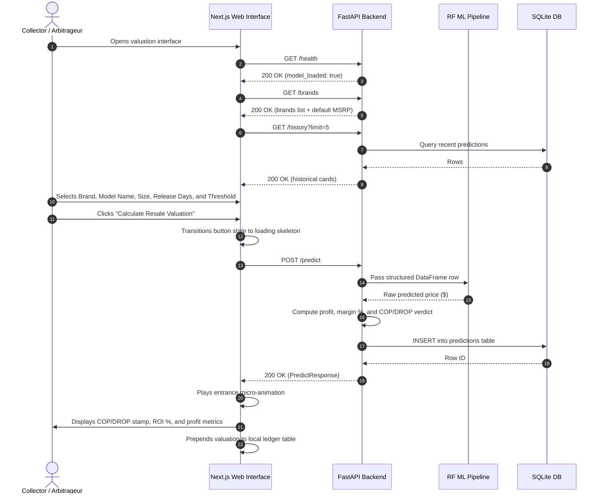
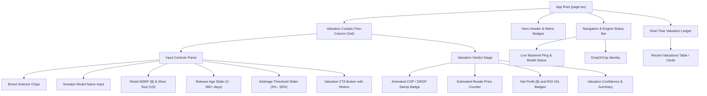

# Phase 1: Codebase Reconnaissance & Master Architecture Plan

> **Project:** DropOrCop - Sneaker Resale Profit Predictor  
> **Tech Stack:** FastAPI Backend (`api/main.py`), SQLite WAL (`src/db.py`), Scikit-Learn Pipeline (`models/best_model.joblib`), Next.js 16 / React 19 Frontend (`frontend/vibe-coding-ui`).

---

## 1. System Inventory

| Component | Technology | File Path | Function |
| :--- | :--- | :--- | :--- |
| **API Server** | FastAPI, Uvicorn, Pydantic v2 | `api/main.py` | Exposes REST endpoints; manages ML lifecycle and thread safety. |
| **Persistence** | SQLite3 (WAL mode) | `src/db.py` | Records prediction logs in `data/droporcop.db`; indexes queries by timestamp and brand. |
| **ML Engine** | Scikit-Learn Pipeline, Joblib | `models/best_model.joblib` | Random Forest regressor with one-hot encoding and keyword extractor. |
| **Feature Layer** | Custom Scikit Transformer | `src/feature_extractor.py` | Derives hype and silhouette binary flags from sneaker text. |
| **Frontend** | Next.js 16 (App Router), React 19, Tailwind CSS v4, Motion | `frontend/vibe-coding-ui` | Client interface for valuation entry and result rendering. |

---

## 2. System Architecture



---

## 3. Database Schema Specification (`data/droporcop.db`)



- **Table:** `predictions`
- **Index 1:** `idx_predictions_timestamp ON predictions (timestamp DESC)`
- **Index 2:** `idx_predictions_brand ON predictions (brand)`
- **PRAGMA Settings:** `journal_mode=WAL`, `synchronous=NORMAL`

---

## 4. API Integration Contracts

### Contract 1: `GET /health`
- **Response:**
```json
{
  "status": "healthy",
  "service": "DropOrCop API",
  "model_loaded": true,
  "model_status": "connected"
}
```

### Contract 2: `GET /brands`
- **Response:**
```json
{
  "brands": ["Yeezy", "Off-White", "Jordan", "Nike", "adidas", "New Balance"],
  "total": 6,
  "default_retail": {
    "Yeezy": 220.0,
    "Off-White": 190.0,
    "Jordan": 200.0,
    "Nike": 150.0,
    "adidas": 130.0,
    "New Balance": 160.0
  }
}
```

### Contract 3: `POST /predict`
- **Request Body:**
```json
{
  "brand": "Yeezy",
  "retail_price": 220.0,
  "shoe_size": 10.5,
  "days_since_release": 45,
  "sneaker_name": "Yeezy Boost 350 V2 Zebra",
  "threshold": 0.15
}
```
- **Response:**
```json
{
  "brand": "Yeezy",
  "retail_price": 220.0,
  "shoe_size": 10.5,
  "days_since_release": 45,
  "estimated_resale_price": 340.91,
  "estimated_profit": 120.91,
  "profit_margin_pct": 54.96,
  "verdict": "COP",
  "sneaker_name": "Yeezy Boost 350 V2 Zebra"
}
```
- **Decision Invariant:**
  $$\text{verdict} = \begin{cases} \text{COP} & \text{if } \frac{\text{estimated\_profit}}{\text{retail\_price}} \ge \text{threshold} \\ \text{DROP} & \text{otherwise} \end{cases}$$

### Contract 4: `GET /history?limit={limit}`
- **Query Parameter:** `limit` (Integer, 1-100, default 10)
- **Response:**
```json
{
  "total": 1,
  "predictions": [
    {
      "id": 1,
      "timestamp": "2026-11-18 07:42:01",
      "brand": "Yeezy",
      "retail_price": 220.0,
      "shoe_size": 10.5,
      "days_since_release": 45,
      "estimated_resale_price": 340.91,
      "profit": 120.91,
      "margin_pct": 54.96,
      "verdict": "COP",
      "sneaker_name": "Yeezy Boost 350 V2 Zebra"
    }
  ]
}
```

---

## 5. End-to-End Sequence & User Journey



---

## 6. Required UI Views & Component Breakdown


